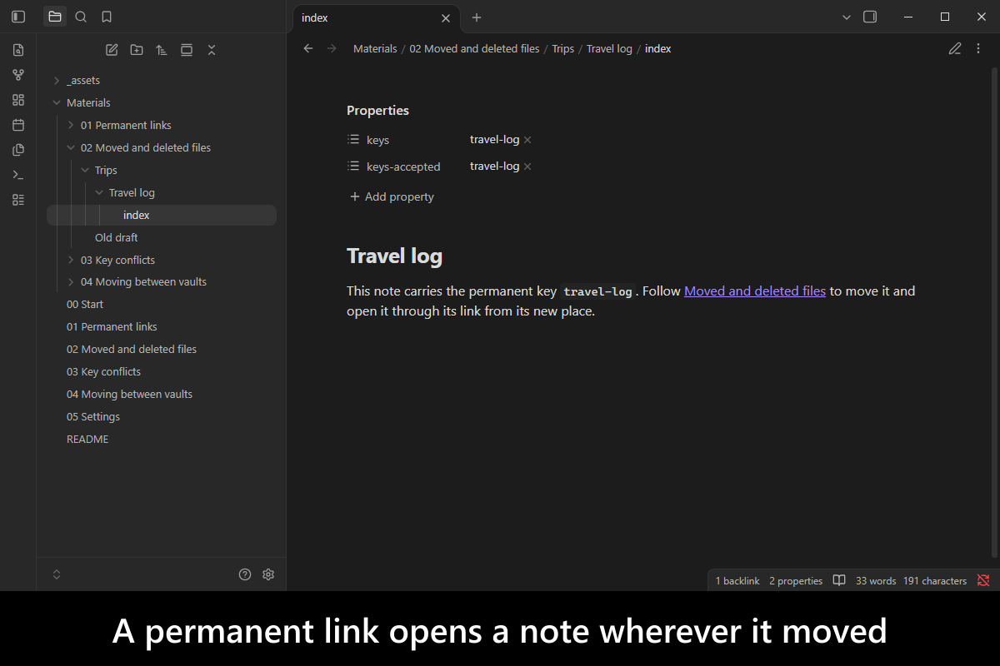
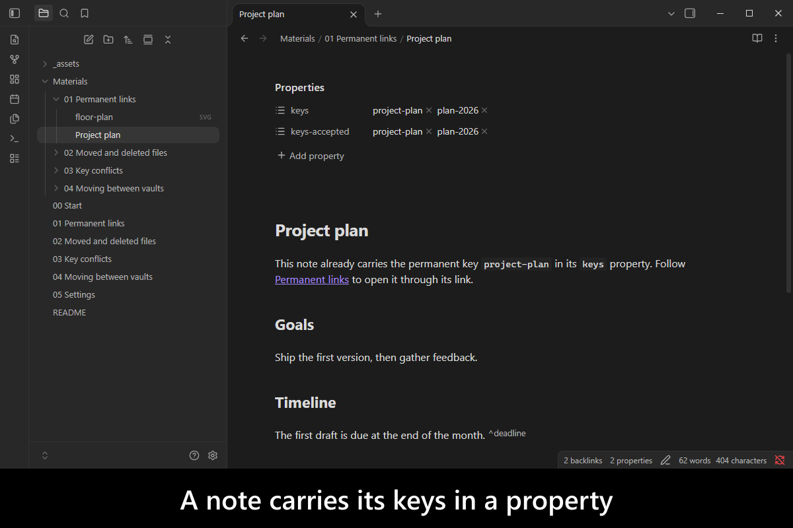
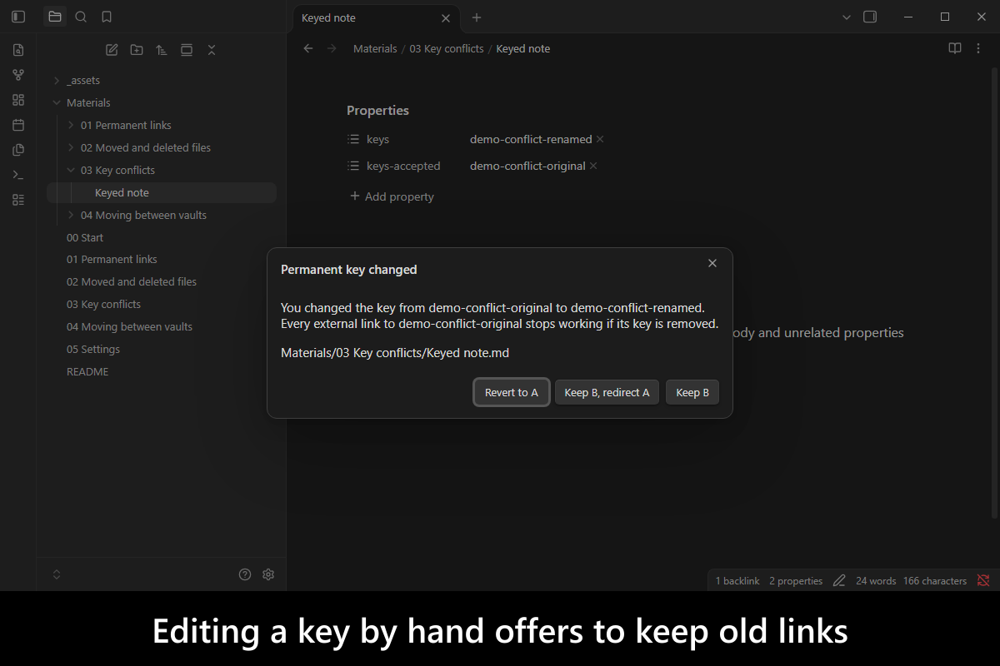
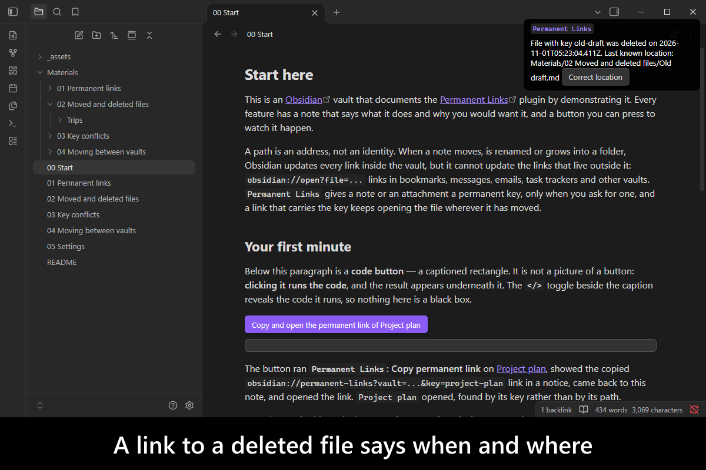
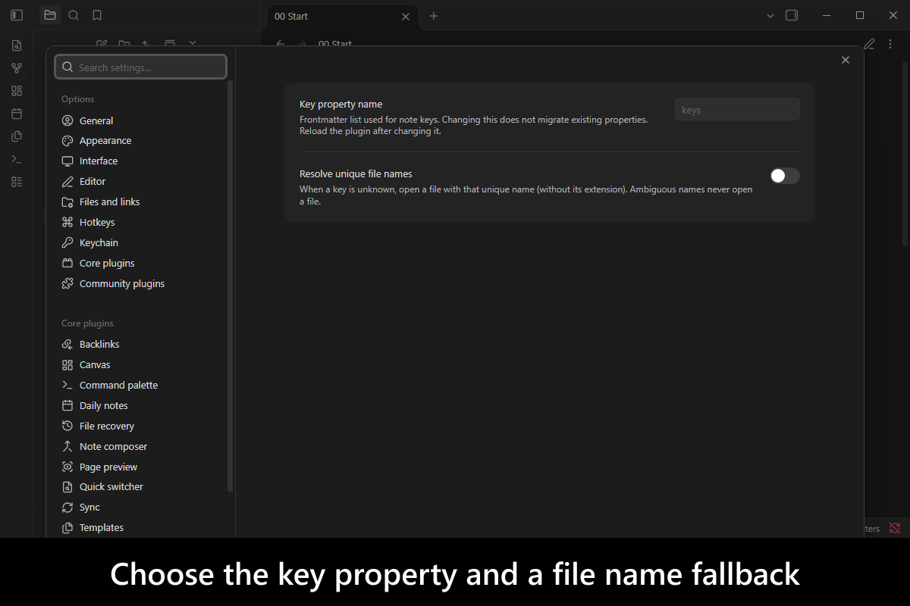
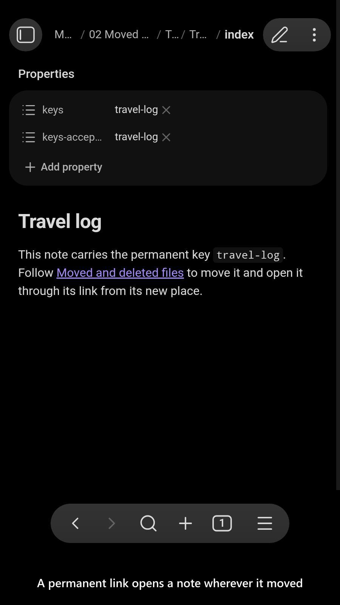
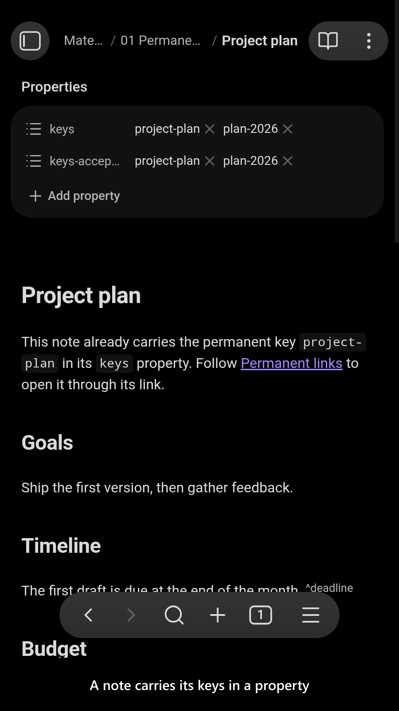
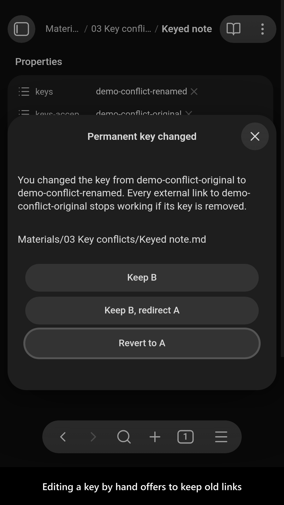
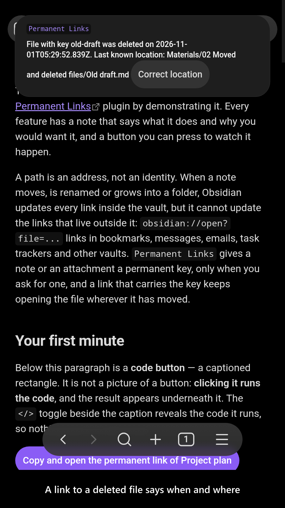
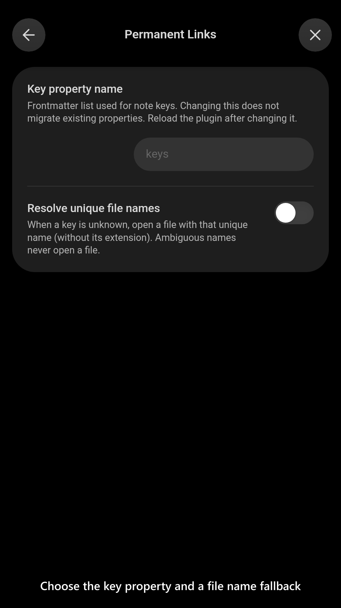

# Permanent Links

[](https://www.buymeacoffee.com/mnaoumov) [](https://github.com/mnaoumov/obsidian-permanent-links/releases) [](https://github.com/mnaoumov/obsidian-permanent-links/releases) [](https://github.com/mnaoumov/obsidian-permanent-links)

A path is an address, not an identity. When a note moves, is renamed or grows into a folder, Obsidian updates every link inside the vault, but it cannot update the links that live outside it: `obsidian://open?file=...` links in bookmarks, messages, emails, task trackers and other vaults. Each of those breaks the first time the file moves.

`Permanent Links` gives a note or an attachment a permanent key, only when you ask for one, and copies a link that carries the key. The link keeps opening the file wherever it has moved since, and says so plainly when the file was deleted. A note carries its keys in a frontmatter property, readable by any tool, so nothing about the key is hidden in the plugin.

Ids that survive a move are a long-standing request: people in the Obsidian community have asked for them since at least 2021.

<!-- markdownlint-disable MD033 -->

<a href="https://github.com/mnaoumov/obsidian-permanent-links/blob/HEAD/images/screenshots/screenshot-desktop-1.png"></a>

<details>
<summary>More screenshots</summary>

<div>
<a href="https://github.com/mnaoumov/obsidian-permanent-links/blob/HEAD/images/screenshots/screenshot-desktop-2.png"></a>
<a href="https://github.com/mnaoumov/obsidian-permanent-links/blob/HEAD/images/screenshots/screenshot-desktop-3.png"></a>
<a href="https://github.com/mnaoumov/obsidian-permanent-links/blob/HEAD/images/screenshots/screenshot-desktop-4.png"></a>
<a href="https://github.com/mnaoumov/obsidian-permanent-links/blob/HEAD/images/screenshots/screenshot-desktop-5.png"></a>
<a href="https://github.com/mnaoumov/obsidian-permanent-links/blob/HEAD/images/screenshots/screenshot-mobile-1.png"></a>
<a href="https://github.com/mnaoumov/obsidian-permanent-links/blob/HEAD/images/screenshots/screenshot-mobile-2.png"></a>
<a href="https://github.com/mnaoumov/obsidian-permanent-links/blob/HEAD/images/screenshots/screenshot-mobile-3.png"></a>
<a href="https://github.com/mnaoumov/obsidian-permanent-links/blob/HEAD/images/screenshots/screenshot-mobile-4.png"></a>
<a href="https://github.com/mnaoumov/obsidian-permanent-links/blob/HEAD/images/screenshots/screenshot-mobile-5.png"></a>
</div>

</details>

<!-- markdownlint-enable MD033 -->

## Demo vault

**The documentation is an interactive demo vault.** Every feature has a note that explains what it does and why you would want it, with a button that copies, opens, moves or deletes a supplied file so you can watch the link keep working.

**[Start reading here](<./demo-vault/00 Start.md>)** — it is plain markdown, so it works on GitHub with nothing installed.

A copy of the vault ships with every release. You can access it via any of the following:

1. Running the **`Permanent Links`: Open demo vault** command.
2. Downloading `permanent-links-demo-vault.zip` from the [Releases](https://github.com/mnaoumov/obsidian-permanent-links/releases). It unzips into a single `permanent-links-demo-vault-<version>` folder.
3. Browsing its source in [`demo-vault/`](./demo-vault/README.md) in this repository.

## What it does

- **Copy permanent link** gives the active file a generated key if it has none (12 letters and digits, or a GUID without hyphens if you prefer that shape) and copies `obsidian://permanent-links?vault=<vault>&key=<key>`. The link opens the file wherever it is, at a heading or a block if you add one: see [Permanent links](<./demo-vault/01 Permanent links.md>).
- **Set key** adds a readable key in any script, such as `plan-2026`, as an alias that keeps older links working; **Remove key** asks before removing one: see [Permanent links](<./demo-vault/01 Permanent links.md>).
- **Attachments** get keys too, kept in the plugin's readable `keys.json` because an attachment has no frontmatter: see [Permanent links](<./demo-vault/01 Permanent links.md>).
- **Moves, renames and deletions** are followed: a moved file's link opens it at its new path, a deleted file's link says when it was deleted and where it last was, and a restored file gets its keys back: see [Moved and deleted files](<./demo-vault/02 Moved and deleted files.md>).
- **Conflicts** are repaired safely: a copied note loses the duplicate key, a key edited by hand opens a dialog whose default keeps old links working, and a core `Note Composer` merge offers to move the merged note's keys: see [Key conflicts and manual edits](<./demo-vault/03 Key conflicts.md>).
- **Moving to another vault**: tell the old vault where a file went, and its old links forward there: see [Moving between vaults](<./demo-vault/04 Moving between vaults.md>).

Every setting is listed by its `data.json` key in [Settings](<./demo-vault/05 Settings.md>).

## See also

[My other Obsidian resources](https://github.com/mnaoumov/obsidian-resources)

| Plugin | Features | How `Permanent Links` differs |
| --- | --- | --- |
| [`Add an ID to the front matter`](https://community.obsidian.md/plugins/guid-front-matter) | adds a globally unique id to the frontmatter of every note | Covers part of it: writes ids, but opens nothing by them; keys a file only when asked; keys attachments too |
| [`Advanced URI`](https://community.obsidian.md/plugins/obsidian-advanced-uri) | `obsidian://adv-uri` links for many actions; opens a note by a frontmatter id field; can generate the id | Same goal for links to notes: adds attachments; an index instead of a scan; duplicate repair; a record of deleted files; a warning when a key is edited by hand; forwarding to another vault |
| [`Note UID Generator`](https://community.obsidian.md/plugins/note_uid_generator) | generates unique ids for notes, automatically or by command, into frontmatter | Covers part of it: writes ids, but opens nothing by them; keys attachments too |

Last searched for similar plugins on 2026-10-31.

## For plugin developers

This plugin publishes an API, declared in [api.d.ts](./api.d.ts), for plugins that want to read a file's keys, resolve a key to a file, assign or add a key, or move keys from one file to another when they merge notes.

```ts
import { watchPluginApi } from '@mnaoumov/obsidian-lib/plugin/plugin-api';

import type { PermanentLinksApi } from './api.d.ts';

const apiRef = watchPluginApi<PermanentLinksApi>({
  apiVersionRange: '^1.1.0',
  app: this.app,
  component: this,
  pluginId: 'permanent-links'
});

// `value` is always current: `null` while this plugin is not loaded, and non-`null` on its own once it is.
const api = apiRef.value;
if (api) {
  console.log(api.getKeys(file)); // ['project-plan', 'plan-2026']
}
```

The handle comes from the `@mnaoumov/obsidian-lib` plugin registry; [Cross-plugin APIs](https://mnaoumov.dev/obsidian-lib/guides/cross-plugin-apis/) covers `watchPluginApi` and the registry from the library's side. The contract version is `1.1.0`, and it moves independently of the plugin's own version, so ask for a range.

If you would rather not depend on `@mnaoumov/obsidian-lib` for the handle, the registry is a documented wire protocol you can read directly — see [Plugin API protocol](https://mnaoumov.dev/obsidian-lib/guides/plugin-api-protocol/).

## Installation

The plugin is not yet listed in [the official Community Plugins repository](https://community.obsidian.md/plugins). Until it is, install it as a beta release.

### Beta versions

To install the latest beta release of this plugin (regardless if it is available in [the official Community Plugins repository](https://community.obsidian.md) or not), follow these steps:

1. Ensure you have the [BRAT plugin](https://community.obsidian.md/plugins/obsidian42-brat) installed and enabled.
2. Click [Install via BRAT](https://intradeus.github.io/http-protocol-redirector?r=obsidian://brat?plugin=https://github.com/mnaoumov/obsidian-permanent-links).
3. An Obsidian pop-up window should appear. In the window, click the `Add plugin` button once and wait a few seconds for the plugin to install.

## Debugging

By default, debug messages for this plugin (id: `permanent-links`) are hidden.

If you need to enable them refer to the [documentation](https://mnaoumov.dev/obsidian-lib/guides/debugging/).

## Contributing

Contributions are welcome — see [CONTRIBUTING](./CONTRIBUTING.md) to get set up.

## Support

<!-- markdownlint-disable MD033 -->

<a href="https://www.buymeacoffee.com/mnaoumov" target="_blank"></a>

<!-- markdownlint-enable MD033 -->

### Filing an issue (for AI agents and humans)

Open issues through the [issue forms](https://github.com/mnaoumov/obsidian-permanent-links/issues/new/choose), not as blank issues.

To report a bug from inside Obsidian, run the **`Permanent Links`: Report a bug** command. It opens the bug form with the plugin version, the Obsidian version and your operating system already filled in.

Filing from the CLI or the API (`gh issue create --body`, or an AI agent filing for you) skips the form, and `gh issue create --template` cannot load an issue form. In that case, open the matching form in [`.github/ISSUE_TEMPLATE/`](https://github.com/mnaoumov/obsidian-permanent-links/tree/HEAD/.github/ISSUE_TEMPLATE), copy every field as a `### <label>` heading in the form's order, and fill in each one. Always state the plugin version, the Obsidian version and your operating system.

## License

© [Michael Naumov](https://github.com/mnaoumov/)
